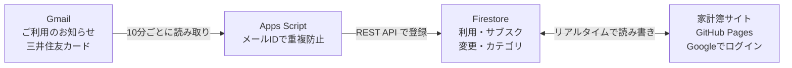

# カード家計簿 仕様書

2026-10-31 時点

## 1. 概要

三井住友カードの「ご利用のお知らせ」メールを自動で読み取り、カードの利用額と次の支払額を管理する自分用の家計簿サイト。リポジトリは [daichi-ui/card-kakeibo](https://github.com/daichi-ui/card-kakeibo)、公開先は [GitHub Pages](https://daichi-ui.github.io/card-kakeibo/)。

手入力とサブスクはサイトから直接 Firestore に書き込み、Gmail 分と同じ集計に入る。

| 項目 | 内容 |
| --- | --- |
| 利用者 | 本人のみ（Google アカウントでログイン） |
| 締め日・支払日 | 月末締め・翌月25日払い（休業日は翌営業日） |
| 取り込み対象 | `statement@vpass.ne.jp` からの件名「ご利用のお知らせ」、2026/10/01 以降 |
| 取り込み間隔 | 10分ごと |
| 画面 | 素の HTML / CSS / JavaScript（ES モジュール、ビルドなし） |
| データベース | Firebase Cloud Firestore（Firebase SDK 10.12.2） |
| 認証 | Firebase Authentication（Google ログイン） |
| 取り込み処理 | Google Apps Script（V8、タイムゾーン Asia/Tokyo） |
| デザイン | Apple Human Interface Guidelines を参考 |

## 2. 画面仕様

下部のタブで4画面を切り替える。URL の `#home` などでタブを直接開ける。ヘッダーは日付と大きな画面名で、スクロールすると小さな画面名のバーに変わる。ホームと明細では右下の「＋」ボタンで手入力を追加する（明細のカレンダー表示中は選んだ日付で追加）。

| 画面 | 表示内容 | 操作 |
| --- | --- | --- |
| ホーム | 要確認のお知らせ（あるときだけ）、次のお支払い（金額・支払日・あと何日・利用月）、先月の利用と前月比、今月のサブスク合計 | お知らせをタップで要確認に絞った明細へ。カードをタップで該当月の明細／設定へ |
| 明細 | 月の合計・支払日・件数。「リスト」（日付ごとの利用一覧）と「カレンダー」（日ごとの支出合計と、選んだ日の利用）を切り替え | 月の前後移動、合計やカレンダーのスワイプで月移動。虫めがねで検索（お店・カテゴリ・メモ・種類）と絞り込み（すべて／要確認／サブスク／手入力／除外中） |
| レポート | 期間の合計と前期間比（年は月平均も）、カテゴリ別の円グラフと一覧、月別の棒グラフ | 月／年の切り替え、前後移動、スワイプ、棒をタップでその月へ |
| 設定 | サブスク（今月の合計と一覧）、カテゴリ（色と使用件数）、未登録カテゴリ、アカウント | サブスク・カテゴリの追加・編集、未登録カテゴリの登録、ログアウト |

**一覧の行**

- 左にカテゴリの色の丸（カテゴリ名の頭文字）、中にお店と「時刻・カテゴリ」（サブスクは「サブスク」も）、右に金額
- バッジは要確認と除外だけ
- タップで編集。左にスワイプすると「除外」（除外中は「戻す」）ボタンが出る
- 除外中の行は取り消し線とグレー表示

**入力画面（下から出るシート）**

金額は上部に大きく表示して入力する。

| シート | 項目 | 備考 |
| --- | --- | --- |
| 利用の追加・編集 | 金額、カテゴリ、お店、日付、時刻、メモ、計算から除外 | 金額はマイナス可（取消）。お店が空なら「手入力」。保存で要確認が外れる |
| サブスク（この月の分） | 今月の金額、今月は計算から除外 | 「通常の金額に戻す」「サブスクの設定を開く」 |
| サブスクの追加・編集 | 金額、名前、カテゴリ、引き落とし日（1〜30日・月末）、開始月、終了月 | 終了月が開始月より前ならエラー |
| カテゴリの追加・編集 | 名前、色（10色） | 使用件数を表示。削除しても利用側のカテゴリ名は残る |

**カテゴリ入力（プルダウン）**

- 入力欄をタップすると、すぐ下に登録済みカテゴリが色付きで開く。入力欄は上に見えたまま
- 空ならすべて表示、文字を入れると部分一致で絞り込む（全角半角・大文字小文字・ひらがなカタカナの違いは無視）。一致した部分を強調する
- 一覧にない文字で保存すると、カテゴリに自動で登録する
- 空のまま保存すると「未分類」

**カテゴリの色**

- 一覧のアイコン、円グラフ、プルダウン、設定で同じ色を使う
- 色を選んでいない登録済みカテゴリは並び順で色を割り当て、未登録のカテゴリは名前から色を決める。未分類はグレー

## 3. 計算ルール

すべての画面は同じ集計関数（`store.js` の `monthItems`）を通すので、Gmail・手入力・サブスクの合計はどの画面でも一致する。

**支払日**（`utils.js`）

1. 利用月の翌月25日を候補にする（`PAYMENT_DAY = 25`）
2. 候補が土曜・日曜・祝日・年末年始（12/31〜1/3）なら、1日ずつ後ろにずらす
3. 次の支払い：今日が先月分の支払日以前なら先月分、過ぎていれば今月分

祝日は内閣府の決まりを計算で求める（1980〜2099年に対応）。

- 固定の祝日：元日、建国記念の日、天皇誕生日、昭和の日、憲法記念日、みどりの日、こどもの日、山の日、文化の日、勤労感謝の日
- ハッピーマンデー：成人の日（1月第2月曜）、海の日（7月第3月曜）、敬老の日（9月第3月曜）、スポーツの日（10月第2月曜）
- 春分の日・秋分の日：天文計算の近似式
- 国民の休日：祝日にはさまれた平日（例：2026/9/22）
- 振替休日：日曜の祝日のあと、最初の祝日でない日

| 利用月 | 支払日 | 理由 |
| --- | --- | --- |
| 2026年3月 | 2026/4/27(月) | 4/25 が土曜 |
| 2026年6月 | 2026/7/27(月) | 7/25 が土曜 |
| 2026年9月 | 2026/10/26(月) | 10/25 が日曜 |
| 2026年10月 | 2026/11/25(水) | 平日 |

**月の合計**

- 対象：その月の利用（`deleted` でないもの）＋ その月に有効なサブスク
- 合計に入れないもの：計算から除外したもの、金額が未入力（要確認）のもの
- 取消（マイナス金額）は差し引く
- サブスクの日付：引き落とし日。月の日数を超える日（31日＝月末など）はその月の末日

**サブスクの月ごとの変更**

- 有効期間：開始月 ≦ 対象月 ≦ 終了月（終了月が空ならずっと続く）
- この月だけの変更は `fixedOverrides`（ID は `<サブスクID>_<YYYY-MM>`）に保存。`amount` があればその金額、`skipped` が true なら計算から除外
- 通常と同じ金額を保存すると `amount` は null に戻る

**レポート**

- 月単位：その月の内訳と、その月までの12か月の推移
- 年単位：その年の内訳と、1〜12月の推移、月平均（年合計 ÷ 12）
- 円グラフはカテゴリの色で多い順に7つまで、8番目以降は「その他」。マイナスのカテゴリは円グラフに含めない
- カレンダーのセルは金額を省略せず表示する（7桁以上は文字を小さくする）

## 4. データ仕様

Firestore に4つのコレクションを持つ。画面は4つとも `onSnapshot` で購読し、変更がすぐ全画面に反映される。日付は日本時間の文字列で持つ。

**transactions**（カードの利用。ID は Gmail 取り込みならメール ID、手入力なら自動）

| 項目 | 型 | 内容 |
| --- | --- | --- |
| `date` | 文字列 | 利用日 `YYYY-MM-DD` |
| `time` | 文字列 | 利用時刻 `HH:mm`（空可） |
| `store` | 文字列 | お店。読み取れないときは「（読み取れませんでした）」 |
| `kind` | 文字列 | 種類（買物など）。取消なら「取消」 |
| `amount` | 整数 / null | 金額（円）。取消はマイナス。読み取れないときは null |
| `category` | 文字列 | カテゴリ。既定は「未分類」 |
| `memo` | 文字列 | メモ |
| `source` | 文字列 | `mail`（Gmail）／ `manual`（手入力） |
| `needsReview` | 真偽 | 要確認。保存すると false |
| `excerpt` | 文字列 | 要確認のとき、メール本文の抜粋（200字まで） |
| `excluded` | 真偽 | 計算から除外 |
| `deleted` | 真偽 | 削除済み（Gmail 分のみ。消すと次の取り込みで再登録されるため印を付ける） |
| `createdAt` | 日時 | 登録日時 |

**fixedCosts**（サブスク）

| 項目 | 型 | 内容 |
| --- | --- | --- |
| `name` | 文字列 | 名前 |
| `amount` | 整数 | 通常の金額（円） |
| `day` | 整数 | 引き落とし日 1〜31（31＝月末） |
| `category` | 文字列 | カテゴリ |
| `startMonth` | 文字列 | 開始月 `YYYY-MM` |
| `endMonth` | 文字列 | 終了月 `YYYY-MM`（空＝ずっと） |
| `createdAt` | 日時 | 登録日時 |

**fixedOverrides**（サブスクのこの月だけの変更。ID は `<サブスクID>_<YYYY-MM>`）

| 項目 | 型 | 内容 |
| --- | --- | --- |
| `fixedId` | 文字列 | 対象のサブスク ID |
| `month` | 文字列 | 対象月 `YYYY-MM` |
| `skipped` | 真偽 | この月は計算から除外 |
| `amount` | 整数 / null | この月だけの金額（null＝通常の金額） |

**categories**（カテゴリ）

| 項目 | 型 | 内容 |
| --- | --- | --- |
| `name` | 文字列 | カテゴリ名（全角英数を半角にそろえ、前後の空白を除く） |
| `color` | 文字列 | 色（`#RRGGBB`） |
| `order` | 数値 | 並び順（登録した順） |
| `createdAt` | 日時 | 登録日時 |

カテゴリ名を変えると、同じカテゴリの `transactions` と `fixedCosts` もまとめて書き換える。カテゴリを削除しても利用側のカテゴリ名は残り、カテゴリ設定の「未登録」に表示される。

## 5. Gmail 取り込み仕様

Google Apps Script（`gas/Code.gs`）が10分ごとに Gmail を検索し、Firestore の REST API で `transactions` に登録する。画面側のコードとは独立している。

**処理の流れ**（`syncCardMails`）

1. 前回の記録日（`LAST_SYNC_DATE`、初回は `startDate`）の1日前以降のメールを、100件ずつ検索する
2. 送信元が `statement@vpass.ne.jp` で、`startDate` 以降のメールだけを対象にする
3. 本文を解析する。テキスト版で読めなければ HTML 版を文字だけにして読み直す
4. メール ID をそのままデータの ID にして登録する。登録済み（HTTP 409）なら飛ばす
5. 次回のために、今日の2日前を `LAST_SYNC_DATE` に記録する（取りこぼし防止）

**本文の読み取り**（`parseCardMail`）

- 全角の英数字・記号を半角にそろえる（NFKC）
- 「ご利用日時：YYYY/MM/DD HH:mm」から日付と時刻を取る
- その後ろの最初の3行から「〜円」で終わる行を探し、そこまでをお店、末尾を金額とする
- お店の末尾の「(買物)」などは種類として分ける
- 「(取消)」が付くか金額がマイナスなら取消とし、金額をマイナスにする
- 円の金額が見つからない（海外利用など）、または日時がないときは要確認にする。要確認は金額を null、本文の抜粋を `excerpt` に入れる
- 日時が読めないときは、メールの受信日時で代用する

**関数一覧**

| 関数 | 用途 |
| --- | --- |
| `setup` | 最初に1回実行。10分ごとの自動実行を登録し、`startDate` 以降を取り込み直す |
| `syncCardMails` | 自動で実行される本体 |
| `testParseLatestMail` | 最新メールの読み取り結果をログに出す（登録しない） |
| `debugLatestMail` | 読み取れないときの調査用。本文の「ご利用日時」周辺を表示 |
| `reparseReviewItems` | 読み取りを直したあとに実行。要確認のメール分を読み直し、読めたものは要確認を外す |

**設定**（`CONFIG`）

| 項目 | 値 |
| --- | --- |
| `projectId` | `card-kakeibo` |
| `startDate` | `2026/10/01` |
| `query` | `from:statement@vpass.ne.jp subject:"ご利用のお知らせ"` |
| `intervalMinutes` | 10 |

**認証**：スクリプトのプロパティ `SERVICE_ACCOUNT` に Firebase のサービスアカウント鍵（JSON）を入れ、JWT を署名してアクセストークンを取る。トークンは50分キャッシュする。必要な権限は Gmail の読み取り、外部への通信、トリガーの管理の3つ。

## 6. ファイル構成

画面は `index.html` が `app.js` を読み込み、各画面のモジュールが `store.js` の状態を購読して描き直す。

| ファイル | 役割 |
| --- | --- |
| `index.html` | 画面の骨組み（4タブ、各シート） |
| `style.css` | デザイン（配色・角丸・影・各部品） |
| `app.js` | ログイン、タブ切り替え、ヘッダー、＋ボタン |
| `firebase.js` | Firebase の初期化（設定はここだけ） |
| `store.js` | Firestore の購読、月の集計、カテゴリの検索と色 |
| `utils.js` | 支払日・祝日の計算、日付・金額の表示、スワイプ |
| `rows.js` | 一覧の1行（カテゴリのアイコン、スワイプで除外）とタップ時の処理 |
| `editor.js` | 利用の追加・編集・削除、サブスクのこの月の変更、除外の切り替え |
| `categories.js` | プルダウン付きの入力欄、カテゴリの追加・編集シート |
| `subs.js` | サブスクの追加・編集シート |
| `home.js` | ホーム画面 |
| `list.js` | 明細画面（リスト・カレンダー・検索・絞り込み） |
| `calendar.js` | 明細のカレンダー表示 |
| `report.js` | レポート画面（円グラフ・棒グラフ） |
| `settings.js` | 設定画面（サブスク・カテゴリ・アカウント） |
| `gas/Code.gs` | Gmail 取り込み（Apps Script） |
| `gas/appsscript.json` | Apps Script の設定（タイムゾーン、権限） |

## 7. 運用・セキュリティ

- **セキュリティルール**：4つのコレクション（`transactions`、`fixedCosts`、`fixedOverrides`、`categories`）を、本人のアカウントだけが読み書きできるようにする。ルールはリポジトリに含まれていないので、Firebase コンソールで管理する
- **許可されていないアカウント**：データを読めない旨を画面上部に表示する。`categories` だけ読めないときは、設定画面のカテゴリ欄にだけ表示し、ほかの画面は使える
- **サービスアカウント鍵**：データベースを自由に操作できる鍵なので、GitHub には絶対に上げない（`.gitignore` で除外済み）。Apps Script のプロパティにだけ置く
- **Firebase の apiKey**：`firebase.js` に書かれているウェブ用のキーは公開前提のもので、安全性はセキュリティルールで守る
- **画面に出す文字**：お店名などはすべて HTML として解釈させない処理（`escapeHtml`）を通す
- **公開**：`main` ブランチに入ると GitHub Pages が自動で公開する。ブラウザが古いファイルを覚えていることがあるので、反映されないときは強制的に再読み込みする
- **取り込みの調整**：開始日や間隔は `gas/Code.gs` の `CONFIG` で変える。読み取りを直したら `reparseReviewItems` を1回実行する
